# AET Eval document-driven generation

The evaluator uploads the complete source set, confirms it, receives an editable
HTML draft and approves a saved version after review. No goal prompt is required.
The workflow uses OpenAI Responses, with a durable application-owned state machine.
The existing Gemini assistant and legacy single-PDF import remain separate tools.

## Run locally

Use the existing `x/aet-eval` worktree. In its ignored `.env.local`, configure
`EVAL_LOCAL_ENABLED=true`, the existing Eval Supabase variables and
`EVAL_OPENAI_API_KEY`. `EVAL_OPENAI_MODEL` defaults to `gpt-6.1-sol` and can be changed
for a model with PDF/image input and strict structured output support.
Never use `NEXT_PUBLIC_` for these keys. Restart local processes after env changes.

Run `pnpm dev:eval` in one terminal and `pnpm worker:eval` in another. The existing
local page is `http://localhost:3023/admin/eval`. Keep the worker running while
confirmed tasks are pending. `pnpm worker:eval --once` processes at most one claim
and exits; it is useful for controlled smoke tests. Multiple workers use database
leases to avoid concurrent processing of one run. This is a local implementation;
production hosting and employee authentication remain outside this phase.

Apply `supabase/migrations/20261017222306_add_aet_eval_generation_workflow.sql` to
the pinned Eval project. Create the private `aet-eval-documents` Storage bucket
through the Storage API with a 20 MiB file limit and PDF/PNG/JPEG/WebP MIME allowlist.
This setup has been applied to `jhaccounting.org & AET` (`qrxztgdemfodemlcabcq`).
Browser roles have no access to workflow tables or RPCs. The server checks local
access, same-origin writes, IDs, file signatures, ownership and stored SHA-256.

## Modules

- `lib/eval/domain/generation.ts`: source, extraction, synthesis, run and review contracts.
- `lib/eval/domain/assemble-generation.ts`: deterministic source mapping, completeness
  checks, evidence, draft assembly and GPA calculation.
- `lib/eval/templates/course-by-course.ts`: fixed template version and approval checks.
- `lib/eval/server/models/openai.ts`: Responses transport and strict structured output.
- `lib/eval/server/agent/runner.ts`: extraction checkpoints, synthesis, validation,
  bounded retry and conditional automatic application.
- `lib/eval/server/repositories/generation.ts`: persisted documents, revisions, jobs
  and approvals through server-only queries and atomic RPCs.
- `lib/eval/server/services/documents.ts`: private source storage and integrity checks.
- `lib/eval/server/services/generation.ts`: confirmation, review and approved export.
- `workers/eval/worker.ts`: durable queue consumer, independent of browser/request lifetime.
- `components/eval/panels/workflow-panel.tsx`: uploads, progress, differences, evidence
  and human confirmation alongside the existing HTML canvas.

```mermaid
flowchart LR
  Upload[Upload source files] --> Confirm[Evaluator confirms complete set]
  Confirm --> Freeze[Freeze materials / template / rule catalog]
  Freeze --> Queue[(Supabase generation runs)]
  Queue --> Worker[Leased background worker]
  Worker --> Extract[Responses: extract each source]
  Extract --> Draft[Responses: propose evaluation]
  Draft --> Check[Preserve source rows / calculate totals / flag issues]
  Check --> HTML[Editable HTML draft]
  HTML --> Review[Human source and report review]
  Review --> Snapshot[(Approved immutable snapshot)]
  Snapshot --> Word[Approved Word export]
  HTML --> Changed[Later saved changes or changed materials]
  Changed --> Review
```

## Behavior and limits

- Up to 8 included files, 20 MiB each. Duplicate file content is reused. Exclusion
  changes the material revision and is reversible; no source is permanently deleted.
- Confirmation freezes file hashes, report baseline, template `2026.1`, model and
  a hash of the reference catalog. Repeated confirmation IDs are idempotent; only
  one active run is allowed per report.
- Each PDF/image is extracted separately, including credit-system and grade legend
  statements. Synthesis must account for every extracted credential/course exactly
  once; invented IDs, omitted rows and incompatible course merges are rejected.
- Source extraction is still AI-derived and can be wrong. Quotations and page numbers
  are review aids, not independent authenticity verification. The complete original
  files remain available for comparison. Large scans and full real-world transcript
  coverage have not been certified by the small synthetic smoke test.
- The migrated rule catalog is **unreviewed**. It is included as a versioned reference,
  never represented as an approved conversion authority. Conversions remain
  `AI_INFERRED`; approved rule curation is future work.
- Blank US conversions do not silently fall back to original credits/grades. Legacy
  rows with absent conversion properties retain their historical fallback behavior.
- A first empty report is filled only if its saved baseline and material revision
  still match. Regeneration is a proposal with current/proposed section differences
  and explicit apply. Signatures are never generated; applying a new draft clears them.
- Calls have a 120-second timeout; leases last 5 minutes and renew between calls.
  A run has at most 24 model calls, with at most 3 automatic attempts and 15-second
  retry delay. Completed extraction checkpoints survive retries. Manual retry does
  not reset the model-call budget. Cancellation revokes the lease; an already-sent
  model request may finish and be billed, but cannot publish its result afterward.
- Approval requires an applied current run, a matching report/material version,
  required fields, review notes and acknowledgment of all review items. The reviewer
  name is explicitly **local and unverified**, pending employee authentication.
- Approved snapshots are append-only to the application role and include source,
  template and rule versions. Saved edits, material changes or a newer run invalidate
  current approval. Official Word is generated only from the approved snapshot.
  Ordinary Word/print remain visibly marked drafts. Historical approvals are retained.
- Responses requests use `store:false`. This does not imply zero data retention or
  override the API project's data policies. No third-party web tools or autonomous
  external searches are enabled. This phase budgets calls, not currency or token usage.
- A storage success followed by a failed document registration can leave an unlinked
  private object; no destructive cleanup is automated in this phase.

## Verification

`pnpm check:eval` runs the domain, mocked server, generation and module-boundary
suites without external calls. `tests/eval/workflow.sql` tests duplicate uploads,
idempotent enqueue, lease exclusion, cancellation, retry, stale edit protection,
approval snapshots, material invalidation and browser-role restrictions inside a
transaction that ends with rollback. Run it only against the intended Eval database.

Live verification uses only the pre-existing archived synthetic QA report and a
clearly fictional one-page transcript. No client material is sent for smoke tests.

### Verified local session

The existing development server at port 3023 was reused without restart. The worker
was started with `pnpm worker:eval` and remains running for confirmed uploads.
Regression results: 11 domain, 13 server and 11 generation checks, plus dependency
boundaries. Typecheck, localization and whitespace checks passed. In-app browser
checks passed at 1440px, 390px and 320px; no warnings/errors were captured.
The synthetic report remains archived and awaiting renewed confirmation after the
post-approval edit test. No real client report was approved or modified.
