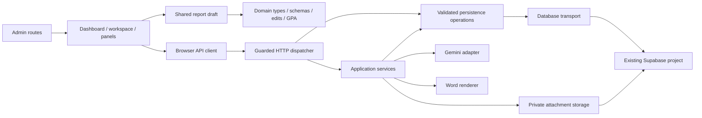

# AET Eval Refactor Checklist

## Scope and invariants

Prepare the existing Eval application for a document-driven generation workflow.
This phase changes code organization, not the report format or product workflow.

- Work in the existing `x/aet-eval` worktree.
- Preserve `/admin/eval`, existing API URLs, migrated report JSON, and database RPCs.
- Keep the editable HTML report as the default view, one shared draft, explicit save,
  collapsible Fields/AI/History, review-before-apply, and unsent AI messages.
- Preserve the 2026 theme, Letter report, Word output, GPA rules, revision history,
  archive recovery, local-only access, same-origin writes, and private attachments.
- Preserve database schema and original report data; reuse archived synthetic QA reports
  for save/recovery checks. Do not introduce employee login, deploy, or push.

## Phase 1 — Structural refactor (current work)

- [x] Separate pure domain types, validation, edits, GPA, and parsed-document mapping.
- [x] Extract browser API utilities from presentation components.
- [x] Split server access, configuration, transport, database, and HTTP utilities.
- [x] Put report/history/chat/rule persistence behind repositories.
- [x] Separate application services from the HTTP dispatcher; preserve API contracts.
- [x] Separate the Gemini provider from PDF and assistant business logic.
- [x] Place Word rendering under server renderers; retain current HTML template.
- [x] Group dashboard, workspace, panels, imports, and report pagination by purpose.
- [x] Extract draft lifecycle, history, import dialog, and toolbar from the editor.
- [x] Remove verified unused legacy implementations rather than create parallel paths.
- [x] Organize regression tests under `tests/eval`, retaining a simple check command.
- [x] Check domain behavior, API errors/security, atomic-save mapping, and module boundaries.
- [x] Run type and localization checks; do not run a production build.
- [x] Verify existing API reads and Word export against synthetic report data.
- [x] Verify desktop/mobile inline editing, shared draft, panel retention, history,
      preview, and save/reload in the in-app browser.
- [x] Document the implemented structure and verification limits.

## Phase 2 — Document-driven Agent (future, not implemented here)

- [ ] Add durable document storage, upload batches, and explicit upload-complete action.
- [ ] Freeze a material-set revision and select the report template automatically or by choice.
- [ ] Add persisted generation runs/steps with idempotency, retry, cancellation, and budgets.
- [ ] Run extraction, evidence mapping, approved-rule conversion, report drafting, and checks.
- [ ] Track source file/page evidence, conflicting facts, missing materials, and assumptions.
- [ ] Version templates and conversion rules; do not automatically trust migrated rules.
- [ ] Produce a full pending-review HTML draft without asking users to formulate a goal.
- [ ] Protect human edits on regeneration with proposed differences and explicit apply.
- [ ] Add human review and approval of a frozen report/material/template/rule snapshot.
- [ ] Require renewed approval after changes and export official documents only from approval.
- [ ] Introduce accountable reviewer identity before multi-user approvals (employee login deferred).
- [ ] Add background workers and progress/recovery UI only when durable generation is implemented.

## Implemented structure

```text
app/
  admin/eval/                      # Existing dashboard/editor pages and CSS
  api/admin/eval/[[...path]]/      # Five-line Next.js runtime/handler entry
components/eval/
  dashboard/dashboard.tsx         # Report list and grade-reference view
  workspace/
    editor.tsx                    # Composes the document and side tools
    use-report-draft.ts           # One draft, dirty state, load/save and Word download
    toolbar.tsx                   # Controlled view/panel/print actions
  panels/
    fields-panel.tsx              # Structured editing of the same draft
    assistant-panel.tsx           # Chat, image context, proposal review
    history-panel.tsx             # Revision selection, draft restore, archive action
  imports/pdf-import-dialog.tsx   # Existing PDF extraction/review/apply dialog
  report/
    report-canvas.tsx             # Inline HTML editor / read-only print preview
    pagination/                   # Measurement and stable page membership
    sections/                     # Current Letter report sections
    ui/                           # Editable report elements and page layout
  ui/                             # Workspace navigation and shared controls
lib/eval/
  domain/                         # Pure report/record types, schemas, GPA, edits,
                                  # AI change application and parsed-document mapping
  client/api.ts                   # Browser JSON/multipart API client
  assets.ts, assets/              # Existing signature allowlist and private assets
  resources/references.json      # Existing bibliographic reference catalog
  utils.ts                       # Shared class-name helper
  server/
    access.ts, errors.ts          # Local-only guard and sanitized application errors
    config.ts, transport.ts       # Pinned project config and private server requests
    database.ts, storage.ts       # Database errors and attachment URL/path boundaries
    http/                         # Dispatch, input parsing, limits, HTTP responses
    repositories/                 # Report/history/chat/rule queries and atomic RPCs
    services/                     # Report reads, PDF import, AI proposals/conversation,
                                  # private attachments/assets and Word export
    models/                       # Gemini adapter, model output schemas/instructions
    renderers/docx/               # Existing Word template and section generators
 tests/eval/                      # Domain, server contract and boundary suites
   support/loader.cjs            # TypeScript loader with isolated provider substitution
 scripts/check-eval.cjs           # Compatibility entry for all three suites
 supabase/migrations/             # Existing migrations, unchanged
```

The report JSON and inherited `SampleData` type retain their shape for migrated
records. The HTML template stays with the report renderer; the Word template stays
under server renderers. A versioned template registry will be added with generation,
when template identity can be stored on a run and approved snapshot. No empty Agent,
worker, review, or upload-batch modules were added in this structural phase.



### Dependency rules

- Browser components use domain modules and the browser API client. They never
  import server credentials, database/storage access, the model SDK, or Word renderer.
- Domain modules have no React, Next.js, HTTP, or persistence dependencies.
- Services use domain rules, repositories, storage, and the model adapter. They
  return values/bytes; the HTTP layer owns Request/Response serialization.
- The Gemini adapter owns provider configuration, timeout, rate limiting, structured
  response parsing, and sanitized provider errors. PDF and assistant workflows own
  business instructions and report constraints.
- The draft hook owns persistence and dirty tracking. Side tools apply changes to
  that draft; they do not create a second report state. AI stays mounted after first
  opening, and switching panels does not remount the report canvas.
- Existing routes are deliberately retained: reports, history, revision, chat, rules,
  assets, attachments, parse, ai, and export. A compact dispatcher keeps one access
  guard/error boundary and avoids unnecessary URL migration during this refactor.
- Removed only unreferenced inherited implementations: `use-report-data`,
  `report-evidence-panel`, and `reference-lookup`. Active evidence fields, conversion
  labels, reference catalog, and current rule lookup remain intact.

### Future feature placement

| Capability | Planned home when implemented |
| --- | --- |
| Material-set/document/run/review contracts | `lib/eval/domain/` |
| Versioned report definitions and required fields | `lib/eval/templates/` |
| Documents, generation, reviews and snapshot persistence | `lib/eval/server/repositories/` |
| Upload-complete, generation, approval and approved exports | `lib/eval/server/services/` |
| Bounded runner, tools, policies and resumable steps | `lib/eval/server/agent/` |
| Durable execution process | `workers/eval/` |
| Upload, progress, evidence, issues and approval UI | `components/eval/` |
| New API entry points | `app/api/admin/eval/` |
| Schema evolution | `supabase/migrations/` |

## Acceptance evidence — 2026-10-17

- `pnpm check:eval`: 11 preserved domain/security checks, 13 server contract checks,
  and a dependency-boundary check passed. The server suite uses synthetic data and
  mocked external responses; it does not spend AI credits or write real data.
- Server tests cover local/origin guards, limits, validation, unknown paths,
  pagination, missing records, atomic save/archive RPCs and conflicts, redacted
  database errors, private attachments, cross-report image rejection, proposal
  filtering, chat insertion with an empty DB response, chronological image proxying,
  PDF signature checks, extracted-fact preservation and missing-course rejection.
- `pnpm typecheck`, `pnpm check:i18n`, and whitespace checks passed. No production
  build was run. No new dependency or lockfile change was needed.
- Existing local server on `http://localhost:3023` was reused without restart.
  Reports, report detail, history, revision, chat, rules and asset API reads passed.
  A Word export of the archived synthetic report returned a valid 26-entry DOCX
  package containing the applicant and converted course values. Public `/`, `/zh`,
  `/es`, and `/admin/eval/new` returned 200.
- In-app browser checks passed at 1440px, 390px and 320px: HTML-to-form and
  form-to-HTML edits, panel collapse, retained unsent AI input, save/reload, new
  history revision, restoration to draft, read-only preview (zero document textboxes),
  and PDF import dialog open/close. Mobile tools remain above the report; there is
  no document-level horizontal overflow. No browser warnings/errors were captured.
- Save/restore testing used the pre-existing archived QA report. Its original content
  was restored using normal revision/save operations; the two QA history revisions
  remain. No original report, database schema, or access policy was changed.
- Screenshots: `output/playwright/aet-eval-refactor-desktop.png` and
  `output/playwright/aet-eval-refactor-mobile.png`.
- Live Gemini generation remains unverified because the previously configured
  provider reported depleted credits. This pass exercised AI orchestration with
  mocks, not a successful live generation. Actual printer/PDF output and full Word
  visual fidelity were not reverified. Employee login and final approval remain
  future work; current exports preserve the existing draft-export behavior.
- Implementation and verification were completed in `x/aet-eval`. Delivery is tracked
  in Git; this refactor does not deploy or change production.
